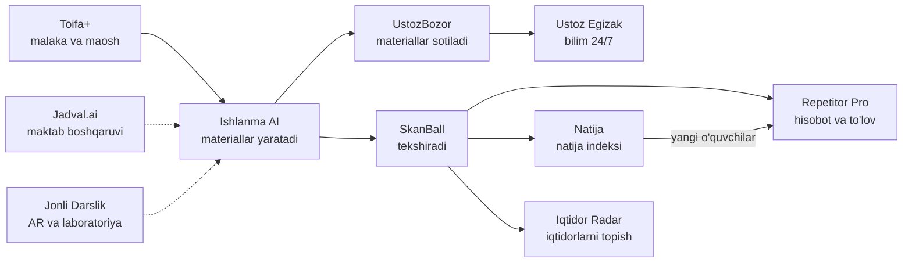

# Ustozlar uchun 10 ta IT-startap

*Maktab o'qituvchilari, repetitorlar va umuman barcha ustozlar uchun foydali, daromadli va kreativ loyihalar — batafsil ishlab chiqilgan konsepsiyalar.*

> **Muhim:** barcha narx, xarajat va daromad hisob-kitoblari — tekshirilishi kerak bo'lgan **gipotezalar**, kafolat emas.
> Hisoblarda shartli ravishda **1 $ ≈ 12 500 so'm** olindi. Tayyorlangan sana: 2026-yil sentabr.
>
> **Shuningdek:** [amalga oshirish rejasi va xarajatlar (PDF)](ustozlar-uchun-10-startap-reja.pdf) · [O'zbekiston uchun eng foydali 20 ta IT loyiha](eng-foydali-it-loyihalar.md)

## Mundarija

- [Nega aynan ustozlar va nega aynan hozir?](#nega-aynan-ustozlar-va-nega-aynan-hozir)
- [Barcha loyihalar uchun umumiy tamoyillar](#barcha-loyihalar-uchun-umumiy-tamoyillar)
- [10 ta startap: qisqacha](#10-ta-startap-qisqacha)
- [Startaplar batafsil](#startaplar-batafsil)
- [Solishtirma baho](#solishtirma-baho)
- [Qaysi biridan boshlash kerak?](#qaysi-biridan-boshlash-kerak)
- [90 kunlik ishga tushirish rejasi](#90-kunlik-ishga-tushirish-rejasi)
- [Ustozlar bilan intervyu: 10 ta savol](#ustozlar-bilan-intervyu-10-ta-savol)
- [Huquqiy va amaliy maslahatlar](#huquqiy-va-amaliy-maslahatlar)
- [Manbalar](#manbalar)

---

## Nega aynan ustozlar va nega aynan hozir?

| Ko'rsatkich (2025/2026 o'quv yili) | Qiymat |
|---|---|
| Umumta'lim maktablari | **11 118** ta (shundan xususiy — **551**, bir yilda +21%) |
| O'quvchilar | **6,87 mln** |
| O'qituvchilar | **577,7 ming** |

Bunga minglab o'quv markazlari, yuz minglab repetitorlar va pedagogika OTM talabalari qo'shiladi.

**Imkoniyat oynasi — nima o'zgardi:**

1. **Attestatsiya qat'iylashdi.** 2025-yildan umrbod malaka toifasi berish amaliyoti bekor qilindi (ayrim istisnolar bilan) — ustozlar muntazam attestatsiyadan o'tadi. Attestatsiyada **86 va undan yuqori ball** to'plab, oliy yoki birinchi toifani olgan pedagoglarga **70% ustama** (2 yil muddatga) belgilangan. → Ustozlar o'z malakasiga pul sarflashga tayyor.
2. **Repetitorlik — katta pul oqimi.** Masalan, Toshkentda IELTSga repetitor bilan to'liq tayyorgarlik 12 mln so'mgacha, markazdagi intensiv kurs oyiga ~1,7 mln so'm, bitta mock-test 200–400 ming so'm turadi. → Bu pul oqimini boshqaradigan vositalarga talab bor.
3. **Sun'iy intellekt (SI) o'zbek tilini tushunadi.** Til modellari o'zbekcha matn yozish, qo'lyozmani o'qish va nutqni tahlil qilishni yetarli sifatda bajaradi — va narxi keskin tushdi.
4. **Telegram + Click/Payme** — tayyor tarqatish va to'lov infratuzilmasi: ilova o'rnatmasdan, Mini App orqali ishlash mumkin.
5. **Qonunchilik yumshadi.** 2026-yil martdagi o'zgarishlar bilan shaxsga doir ma'lumotlarning ko'p qismini (shartlar asosida) chet el serverlarida saqlashga ruxsat berildi; biometrik ma'lumotlar esa O'zbekistonda saqlanishi shart.

**Ustozlarning asosiy og'riqlari:**

- 📄 **Qog'ozbozlik** — dars ishlanmasi, taqvim-mavzu reja, hisobotlar.
- ✍️ **Tekshirish** — daftar va testlarga kuniga 1–3 soat.
- 💸 **Maosh cheklangan** — qo'shimcha daromad (repetitorlik) kerak, lekin biznesni yuritish noqulay: to'lov so'rash, jadval, reklama.
- 📈 **Attestatsiya va sertifikat** — tayyorgarlik materiallari tarqoq.
- 🧪 **Jihozlar yetishmaydi** — laboratoriya, ko'rgazmali qurollar.

---

## Barcha loyihalar uchun umumiy tamoyillar

1. **"Vaqt tejaydi yoki pul topib beradi"** — har bir funksiya shu ikki savoldan biriga javob bersin.
2. **Telegram-first** — birinchi versiya Telegram bot yoki Mini App; alohida mobil ilova keyinroq.
3. **O'zbek tilida va milliy o'quv dasturiga moslangan** — lotin va kirill yozuvi, kerak bo'lsa rus va qoraqalpoq tillari.
4. **Arzon** — ustoz uchun narx bir-ikki chashka qahva narxida (15–60 ming so'm/oy); maktab va markazlar uchun alohida tarif.
5. **Internet sust bo'lsa ham ishlasin** — offline rejim, yengil sahifalar.
6. **SI taklif qiladi, ustoz qaror qiladi** — baho, xulosa va javoblarni oxirida inson tasdiqlaydi.
7. **Bolalar ma'lumotlari — muqaddas** — minimal ma'lumot, ota-ona roziligi, shifrlash.

---

## 10 ta startap: qisqacha

| # | Startap | Mohiyati bir jumlada | Kim to'laydi | Asosiy daromad |
|---|---|---|---|---|
| 1 | [Ishlanma AI](#1-ishlanma-ai) | Mavzuni aytasiz — 60 soniyada tayyor dars to'plami va hujjatlar | Ustoz, xususiy maktab | Obuna 29 ming so'm/oy |
| 2 | [SkanBall](#2-skanball) | Test varaqasi va daftarni telefon kamerasi bilan tekshirish | Repetitor, o'quv markazi, maktab | Obuna 49–390 ming so'm/oy |
| 3 | [Repetitor Pro](#3-repetitor-pro) | Repetitorning cho'ntakdagi ofisi: guruh, davomat, avtomatik to'lov eslatmasi | Repetitor | Obuna 59 ming so'm/oy |
| 4 | [UstozBozor](#4-ustozbozor) | Ustozlar o'z materiallarini sotadigan "Spotify modeli"dagi bozor | Ustoz, maktab | Komissiya + obuna |
| 5 | [Ustoz Egizak](#5-ustoz-egizak) | Ustozning 24/7 ishlaydigan SI-nusxasi o'quvchilarga yordam beradi | O'quvchi / ota-ona | Daromad ulushi 30% |
| 6 | [Toifa+](#6-toifa) | Attestatsiyaga tayyorlov + "Dars ko'zgusi" SI-tahlili + mentorlar | Ustoz, xususiy maktab | Obuna + mentor komissiyasi |
| 7 | [Jadval.ai](#7-jadvalai) | Dars jadvalini daqiqalarda tuzish va "zamena" bot | Maktab, kollej | Yillik litsenziya |
| 8 | [Natija](#8-natija) | Natija kafolatli repetitorlar bozori | Ota-ona | Komissiya 12% + kafolat |
| 9 | [Jonli Darslik](#9-jonli-darslik) | Darslik sahifasiga kamerani qarating — 3D model va virtual tajriba | Maktab, homiy, nashriyot | Litsenziya + homiylik |
| 10 | [Iqtidor Radar](#10-iqtidor-radar) | Iqtidorli bolalarni topish tarmog'i: ustoz — "skaut" | Homiy, xususiy maktab | Homiylik + joylashtirish haqi |

---

## Startaplar batafsil

### 1. Ishlanma AI

**Shior:** *"Mavzuni ayting — dars tayyor."*

**Muammo.** O'qituvchi har kuni dars ishlanmasi, tarqatma material, test, taqvim-mavzu reja va hisobotlarga 1–2 soat sarflaydi. Umumiy SI chatbotlar milliy o'quv dasturini, darsliklar mazmunini va maktabda talab qilinadigan rasmiy formatlarni bilmaydi — natijani uzoq tahrirlashga to'g'ri keladi.

**Yechim.** Sinf, fan va mavzu tanlanadi (to'g'ridan-to'g'ri darslik mundarijasidan) → 60 soniyada **to'liq dars to'plami**:

- rasmiy formatdagi **dars ishlanmasi**: maqsad va vazifalar, jihozlar, dars bosqichlari va vaqt taqsimoti (45 daqiqa), interfaol metodlar ("Aqliy hujum", "Klaster", "Venn diagrammasi", "Insert", "Zig-zag" va h.k.);
- 3 darajali **tarqatma material** (kuchsiz / o'rta / kuchli o'quvchilar uchun);
- javob kaliti bilan **10 savollik test**;
- **taqdimot** (PPTX) va uyga vazifa;
- ota-onalar guruhiga yuboriladigan qisqa xabar.

Eksport: DOCX / PPTX / PDF — chop etishga tayyor.

**Asosiy funksiyalar**

- 🎙️ **Ovozli buyruq:** avtobusda ketayotib *"7-sinf, biologiya, fotosintez, sinf kuchsizroq"* deysiz — to'plam tayyor.
- 📅 **Yillik taqvim-mavzu reja** — bir tugmada.
- 🗂️ **Hujjatlar moduli:** sinf rahbari hujjatlari, tarbiyaviy soat rejasi, ota-onalar majlisi bayonnomasi, hisobot shablonlari.
- 🧠 **Sinf profili:** tizim har bir sinfning darajasini eslab qoladi va keyingi materiallarni unga moslaydi.

**✨ Kreativ jihat — "Inspektor rejimi".** Tayyor ishlanmani talablar bo'yicha tekshiradi (maqsad o'lchanadimi, vaqt 45 daqiqaga to'g'ri keladimi, baholash va differensiatsiya bormi) va **"tayyorlik balli"** beradi. Ustoz tekshiruvdan oldin xotirjam bo'ladi.

**Kim foydalanadi.** 577 mingdan ortiq maktab o'qituvchisi, xususiy maktablar, repetitorlar, pedagogika OTM talabalari (amaliyot uchun).

**Daromad modeli**

| Tarif | Narx | Nima kiradi |
|---|---|---|
| Bepul | 0 | Oyiga 3 ta to'plam |
| Ustoz | 29 000 so'm/oy (yoki 249 000 so'm/yil) | Oyiga 40 ta to'plam, barcha eksportlar |
| Maktab | 1,5–3 mln so'm/oy | Barcha o'qituvchilar, umumiy kutubxona, rahbariyat paneli |

**Daromad prognozi (1-yil oxiri, konservativ).** 2 000 pullik ustoz × 29 000 = 58 mln so'm + 15 xususiy maktab × 2 mln = 30 mln → **~88 mln so'm/oy** (yiliga ~1 mlrd so'm sur'atda). Bu o'qituvchilarning bor-yo'g'i ~0,35 foizi.

**Unit-iqtisodiyot (SI xarajati).** Bitta to'plam ≈ 4 ming kiruvchi + 6 ming chiquvchi token. Tejamkor model narxida (1 mln token uchun ~$1 kirish / ~$5 chiqish) bu ≈ 430 so'm, kuchliroq modelda (~$2 / ~$10) ≈ 850 so'm. O'rtacha ustoz oyiga 10–15 ta to'plam yaratsa, xarajat 4–13 ming so'm bo'ladi. **Asosiy hiyla:** milliy dastur yagona — *"7-sinf, fotosintez"* to'plami bir marta sifatli yaratiladi va minglab ustozga faqat kichik moslashtirish bilan beriladi. Kesh kutubxonasi o'sgani sari tannarx nolga intiladi.

**MVP (4–6 hafta).** Telegram bot: 3 ta fan (masalan, ona tili, matematika, biologiya) × 5–11-sinflar; faqat dars ishlanmasi + test; DOCX eksport. 50 ta ustoz bilan bepul sinov.

**Texnologiyalar.** Python (FastAPI) yoki Node.js, PostgreSQL + pgvector (darslik mazmuni bo'yicha qidiruv), LLM API (masalan, Claude), python-docx / python-pptx, aiogram (Telegram bot), Click/Payme.

**Birinchi 1 000 foydalanuvchi.** O'qituvchilar Telegram kanallari va metodbirlashma chatlari; referal dasturi (*"do'stingizni taklif qiling — 1 oy bepul"*); pedagogika OTMlari bilan hamkorlik; Instagram Reels: *"Dars ishlanmasini 60 soniyada yozdim"*.

**Raqobat va xavflar**

- *Umumiy SI chatbotlar bepul* → farqimiz: milliy dasturga moslik, rasmiy format, darslik mazmuni, bir tugmada DOCX.
- *Sifat va xatolar* → metodistlar tekshirgan shablonlar, "ustoz tasdiqlaydi" tamoyili, "xato haqida xabar berish" tugmasi.
- *Davlat bepul platforma chiqarishi* → xususiy maktablar (B2B) va premium funksiyalarga tayanish, davlat bilan hamkorlikka ochiq bo'lish.

---

### 2. SkanBall

**Shior:** *"30 ta varaq — 1 daqiqada tekshirildi."*

**Muammo.** Repetitorlar va o'quv markazlari har hafta abituriyentlar uchun "blok test" / mock-test o'tkazadi — yuzlab javob varaqalari qo'lda tekshiriladi yoki qimmat skaner kerak bo'ladi. Maktab o'qituvchisi esa har kuni o'nlab daftarlarni (diktant, insho, masala yechimlari) tekshiradi.

**Yechim.** Telefon kamerasi — tekshiruv mashinasi:

1. Tizim abituriyent testlari uslubidagi (30–90 savol) javob varaqasini yaratadi → chop etiladi.
2. O'quvchilar to'ldiradi → ustoz telefonni varaqlar ustidan birin-ketin o'tkazadi (ketma-ket skanerlash rejimi).
3. Darhol: ballar, guruh reytingi, har bir savol tahlili (qaysi savolda ko'pchilik yiqildi), har bir o'quvchining zaif mavzulari.
4. Natija avtomatik ravishda ota-onaga Telegram orqali boradi: *"Aziz — 78/90, guruhda 3-o'rin. Zaif mavzu: trigonometriya."*

**Asosiy funksiyalar**

- 📷 **OMR (belgilangan doirachalarni o'qish) — telefonning o'zida**, internet shart emas.
- ✍️ **Qo'lyozma rejimi (SI):** daftar sahifasini suratga olasiz — SI imlo xatolarini (o' va g' belgilarigacha), hisob va mantiqiy xatolarni belgilaydi, mezon (rubrika) bo'yicha baho taklif qiladi, ustoz tasdiqlaydi.
- 🗺️ **Sinf "xato xaritasi":** eng ko'p takrorlangan xatolar ro'yxati.
- 📊 **Dinamika:** har bir o'quvchining haftadan haftaga o'sishi grafikda.

**✨ Kreativ jihat — "Xato xaritasi → 1 tugma → tuzatuvchi mashq".** Sinf qaysi mavzuda yiqilgan bo'lsa, aynan shu xatolar asosida yangi mashq varag'i avtomatik yaratiladi (Ishlanma AI bilan integratsiya).

**Kim foydalanadi.** Repetitorlar, o'quv markazlari, xususiy va davlat maktablari, test markazlari.

**Daromad modeli**

| Tarif | Narx | Nima kiradi |
|---|---|---|
| Bepul | 0 | Oyiga 100 varaq |
| Pro (repetitor) | 49 000 so'm/oy | Cheksiz OMR + oyiga 300 qo'lyozma sahifa |
| Markaz | 390 000 so'm/oy | Bir nechta ustoz, ota-ona hisobotlarida markaz brendi, analitika |

**Daromad prognozi (1-yil oxiri).** 1 000 repetitor × 49 000 = 49 mln + 100 markaz × 390 000 = 39 mln → **~88 mln so'm/oy**.

**Unit-iqtisodiyot.** OMR telefonda ishlaydi — xarajat deyarli nol. Qo'lyozma sahifasini SI orqali tekshirish tejamkor modelda ≈ 40–60 so'm.

**MVP (4–6 hafta).** Javob varag'i generatori + skanerlash + natijani Excel va Telegramga chiqarish. 20 ta repetitor bilan bepul pilot.

**Texnologiyalar.** Flutter (kamera), OpenCV + ArUco markerlar (varaqni tekislash), FastAPI, PostgreSQL, Telegram bot (ota-onalar uchun), SI vision modeli (qo'lyozma).

**Birinchi mijozlar.** Mock-test o'tkazadigan markazlarga bir oylik bepul sinov; markaz nomi yozilgan chiroyli ota-ona hisoboti — o'z-o'zidan reklama.

**Raqobat va xavflar**

- *ZipGrade kabi xorijiy ilovalar* → ularda o'zbek tili, mahalliy test formatlari, ota-onaga Telegram hisobot va qo'lyozma SI yo'q.
- *Yorug'lik yomon, telefon arzon* → markerlar bilan avtomatik tuzatish, shubhali javoblarni ustozga alohida ko'rsatish.
- *SI qo'lyozmani noto'g'ri o'qishi* → "SI taklif qiladi, ustoz tasdiqlaydi".

---

### 3. Repetitor Pro

**Shior:** *"Pulni bot so'raydi — siz dars o'tasiz."*

**Muammo.** Minglab ustozlar repetitorlik qiladi, lekin hisob-kitob daftarda yoki Excelda. Ota-onadan pul so'rash noqulay, qarzdorlar yig'ilib qoladi, jadval Telegram yozishmalari orasida yo'qoladi, ota-onaga professional hisobot berilmaydi. O'quv markazlari uchun CRMlar bor (Modme, UstozCRM va boshqalar), ammo yakka repetitor uchun ular og'ir va qimmat.

**Yechim.** Telegram Mini App — o'rnatish shart emas:

- guruhlar va jadval, 2 bosishda davomat;
- har bir ota-onaga shaxsiy Click/Payme to'lov havolasi;
- **avtomatik muloyim eslatmalar:** *"Hurmatli ota-ona, oktabr oyi uchun to'lov muddati — 5-oktabr"* — ustoz o'zi pul so'rab o'tirmaydi;
- qarzdorlar ro'yxati va oylik daromad hisoboti;
- oyda bir marta ota-onaga SI tuzgan hisobot: davomat + test natijalari (SkanBall bilan) + ustoz izohi.

**Asosiy funksiyalar**

- 🪪 **Ustoz vizitkasi:** shaxsiy sahifa (fanlar, natijalar, narxlar) + sinov darsiga yozilish tugmasi.
- 📋 **Kutish ro'yxati:** guruh to'lganda yangi o'quvchilar navbatga yoziladi, joy bo'shasa xabar boradi.
- 🧾 **Legal ishlash yo'riqnomasi:** o'zini o'zi band qilgan shaxs sifatida ro'yxatdan o'tish va daromadni hisoblash bo'yicha oddiy qo'llanma.
- 📈 **Daromad analitikasi:** qaysi guruh foydaliroq, qaysi oyda o'quvchi kamaydi.

**✨ Kreativ jihat.** Ustozning eng noqulay vazifasi — pul so'rash — to'liq botga o'tadi. Ustiga **"Ota-ona kabineti"**: ota-ona farzandining davomati va natijasini o'zi ko'radi — bu ishonchni oshiradi va o'quvchilarning ketib qolishini kamaytiradi.

**Kim foydalanadi.** Yakka repetitorlar (asosiy segment), 1–3 ustozli kichik markazlar.

**Daromad modeli**

| Tarif | Narx | Nima kiradi |
|---|---|---|
| Bepul | 0 | 10 tagacha o'quvchi |
| Pro | 59 000 so'm/oy | 60 tagacha o'quvchi, avtomatik eslatmalar, hisobotlar |
| Kichik markaz | 199 000 so'm/oy | Bir nechta ustoz, umumiy kassa |

Qo'shimcha imkoniyat: to'lov tizimlari bilan agentlik hamkorligi (o'tgan to'lovlardan ulush) — kelishuvga bog'liq.

**Daromad prognozi (1-yil oxiri).** 1 500 repetitor × 59 000 = 88,5 mln + 100 kichik markaz × 199 000 = 19,9 mln → **~108 mln so'm/oy**.

**Nega to'laydi?** Bot oyiga bitta "unutilgan" to'lovni (300–500 ming so'm) qaytarsa ham, obuna o'zini 5–8 barobar oqlaydi.

**MVP (3–4 hafta).** Guruhlar + davomat + to'lov eslatmalari ("to'landi" belgisi qo'lda qo'yiladi). Keyingi bosqichda Click/Payme integratsiyasi.

**Texnologiyalar.** Telegram Mini App (React + Telegram WebApp SDK), Node.js (NestJS) yoki Python, PostgreSQL, Click/Payme merchant API, rejalashtirilgan eslatmalar (cron / navbat).

**Birinchi mijozlar.** Repetitorlar guruhlarida *"Qarzdorlaringiz ro'yxatini 1 daqiqada tuzing"* degan bepul vosita (lid-magnit); har bir ota-ona xabari ostidagi *"Repetitor Pro orqali yuborildi"* yozuvi — viral effekt.

**Raqobat va xavflar**

- *Markazlar uchun CRMlar* → biz yakka repetitorga yo'naltirilganmiz: Telegram ichida, 5 daqiqada sozlanadi, arzon.
- *"Excel ham bo'laveradi"* → qiymatni pulda ko'rsatish: *"Bu oy bot sizga 1,2 mln so'm qaytardi."*

---

### 4. UstozBozor

**Shior:** *"Bilimingiz — passiv daromadingiz."*

**Muammo.** Ustozlar ajoyib taqdimotlar, tarqatma materiallar, test banklari, olimpiada masalalari yaratadi, lekin undan daromad olmaydi. Boshqalar esa sifatsiz materiallarni Telegram kanallaridan qidiradi. Mualliflik huquqi — tartibsiz.

**Yechim.** Ustozlar tomonidan, ustozlar uchun materiallar bozori:

- muallif materialni yuklaydi va narx qo'yadi (5–50 ming so'm) yoki obunaga qo'shadi;
- **"Cheksiz" obuna — 39 000 so'm/oy:** istalgancha yuklab olish; obuna tushumining **60 foizi mualliflarga** foydalanish ulushiga qarab taqsimlanadi (**Spotify modeli**);
- SI sifat nazorati, plagiat tekshiruvi va avtomatik teglash (sinf, fan, mavzu, darslik sahifasi).

**Asosiy funksiyalar**

- ⭐ Muallif reytingi, "Oltin muallif" nishonlari.
- 📦 To'plamlar: *"7-sinf algebra — butun yil uchun"*.
- ✏️ Sotib olingan materialni Ishlanma AI orqali o'z sinfiga moslashtirish.
- 🧾 **"Buyurtma birjasi":** *"11-sinf kimyo, 50 ta olimpiada masalasi kerak"* — mualliflar taklif beradi.

**✨ Kreativ jihat.** Spotify modeli + buyurtma birjasi: eng yaxshi mualliflar oyiga millionlab so'm passiv daromad oladi — bu ustozlar uchun **yangi kasbiy maqom**.

**Kim to'laydi.** Material izlovchi ustozlar (obuna yoki bir martalik xarid), xususiy maktablar (kutubxonaga kirish — ~1 mln so'm/oy).

**Daromad modeli.** Yakka sotuvlardan 30% komissiya; obuna tushumining 40 foizi platformada qoladi; maktab litsenziyalari.

**Daromad prognozi (1-yil oxiri)**

| Manba | Hisob | Platformaga | Mualliflarga |
|---|---|---|---|
| Obuna | 3 000 × 39 000 = 117 mln | 46,8 mln (40%) | 70,2 mln (60%) |
| Yakka sotuvlar | 80 mln aylanma | 24 mln (30%) | 56 mln (70%) |
| Maktablar | 20 × 1 mln | 20 mln | — |
| **Jami** | | **~91 mln so'm/oy** | **~126 mln so'm/oy** |

**Sovuq start muammosini hal qilish.** Birinchi 100 ta kuchli muallifni (materiallari bor Telegram kanal egalarini) jalb qilish: 3 oy davomida kafolatlangan minimal daromad. Talab tomoni — Ishlanma AI foydalanuvchilari. Har bir material sahifasi Google'da indekslanadi (*"7-sinf fizika taqdimot"* kabi qidiruvlar).

**MVP (4–6 hafta).** Oddiy veb-katalog + Telegram bot, qo'lda moderatsiya, faqat yakka sotuvlar. Obuna modeli — katalog 2 000+ materialga yetganda.

**Texnologiyalar.** Next.js (SEO uchun), PostgreSQL, S3-mos obyekt xotira, Meilisearch (qidiruv), PDF'ga shaxsiy suv belgisi qo'yish, Click/Payme.

**Xavflar**

- *Qaroqchilik (sotib olib Telegramga tarqatish)* → har bir faylga xaridor ismi bilan suv belgisi, veb-ko'ruvchi, tez-tez yangilanadigan to'plamlar — "rasmiy versiya har doim yangiroq".
- *Mualliflik nizolari* → muallif shartnomasi, shikoyat tizimi, plagiat tekshiruvi.

---

### 5. Ustoz Egizak

**Shior:** *"Siz uxlaganingizda ham dars davom etadi."*

**Muammo.** Mashhur ustozning daromadi soatlar soni bilan cheklangan. O'quvchilar imtihon oldidan kechasi soat 23:00 da savol bilan yolg'iz qoladi. Umumiy SI esa ustozning metodikasini bilmaydi va ko'pincha tayyor javobni berib qo'yadi (ko'chirish).

**Yechim.** Ustozning **raqamli egizagi** — shaxsiy SI yordamchi:

1. Ustoz o'z materiallarini yuklaydi: konspektlar, video darslar, yechilgan masalalar, ovozli izohlar.
2. Qoidalarni belgilaydi: *"Tayyor javob berma — yo'naltiruvchi savol ber"*, *"Kvadrat tenglamani mening usulim bilan tushuntir"*.
3. Platforma *"Kamola ustoz AI"* kabi Telegram bot yaratadi — u 24/7 o'quvchilarga ustozning uslubida, uning materiallariga tayanib javob beradi.

**Asosiy funksiyalar**

- 📸 Masala suratini yuborish → ustoz usulida qadamma-qadam **ishora** (sokratik rejim).
- 📊 **Ustoz paneli:** o'quvchilar eng ko'p nimani so'rayapti → keyingi dars uchun tayyor tahlil.
- 🚩 SI ishonchi past bo'lgan javoblar ustozga ko'rib chiqish uchun yuboriladi; ustoz istalgan payt *"o'zim javob beraman"* deya oladi.
- 🔊 (Ixtiyoriy) ustozning **o'z ovozi** bilan javob — faqat uning yozma roziligi bilan.

**✨ Kreativ jihat.** Ustoz **vaqtini emas, bilimini sotadi** — daromad soatlarga bog'liq bo'lmay qoladi. Qo'shimcha foyda: "kechki savollar" analitikasi o'quvchilar aslida nimani tushunmayotganini ko'rsatadi.

**Kim foydalanadi / kim to'laydi.** 30+ o'quvchisi bor repetitorlar va bloger-ustozlar; o'quv markazlari (markaz brendidagi yordamchi). Obunani o'quvchi yoki ota-ona to'laydi.

**Daromad modeli.** O'quvchi obunasi 29–49 ming so'm/oy ("Ustoz X AI"ga kirish). Tushumdan avval SI va to'lov xarajatlari chegiriladi, qolgani **70% ustozga / 30% platformaga** bo'linadi. Markazlar uchun — 990 000 so'm/oy.

**Daromad prognozi (1-yil oxiri).** 200 ustoz × o'rtacha 40 o'quvchi = 8 000 obunachi × 39 000 so'm = 312 mln so'm aylanma. Har bir obunadan ~8 000 so'm SI va to'lov xarajati chiqarilgach, qolgan ~31 000 so'mdan ustozga ~21 700, platformaga ~9 300 so'm tushadi → platforma **~74 mln so'm/oy**, har bir ustoz esa **~870 ming so'm/oy qo'shimcha passiv daromad** oladi.

**Unit-iqtisodiyot.** Bitta javob (kontekst bilan ~3 ming kiruvchi + ~400 chiquvchi token) tejamkor modelda ≈ 60 so'm. Oyiga 100 ta savol ≈ 6 000 so'm. Adolatli foydalanish chegarasi (masalan, oyiga 150 savol) qo'yiladi.

**MVP (6–8 hafta).** 5 ta ustoz uchun qo'lda sozlangan botlar: materiallarni yuklash → RAG → Telegram bot → oddiy ustoz paneli. Ovoz funksiyasi — keyinroq.

**Texnologiyalar.** RAG (PostgreSQL + pgvector), LLM API (masalan, Claude — matn va rasmni tushunadi), Telegram bot, Next.js admin panel, o'zbek tili uchun STT/TTS (ixtiyoriy).

**Xavflar**

- *SI xato javobi (gallyutsinatsiya)* → javoblar faqat ustoz materiallariga tayanadi, manbaga havola beriladi, ishonch past bo'lsa savol ustozga yo'naltiriladi.
- *Ko'chirmachilik* → sokratik rejim sukut bo'yicha yoqilgan.
- *Ovoz klonlash etikasi* → faqat ustozning o'z ovozi, yozma rozilik, har bir ovozli javobda "SI" belgisi; ovoz namunalari biometrik ma'lumot sifatida O'zbekistondagi serverda saqlanadi.
- *Bolalar ma'lumotlari* → ota-ona roziligi, minimal ma'lumot yig'ish.

---

### 6. Toifa+

**Shior:** *"Oliy toifaga — ishonch bilan."*

**Muammo.** Umrbod malaka toifasi bekor qilindi — ustozlar muntazam attestatsiyadan o'tadi, 86+ ball uchun **70% ustama** bor. Bu maoshga bevosita ta'sir qiladi, ammo tayyorgarlik materiallari tarqoq. Bundan tashqari, o'qituvchi o'z darsi haqida xolis fikr deyarli olmaydi: ochiq dars — stress, fikr-mulohaza madaniyati esa rivojlanmagan.

**Yechim — ustozning karyera akseleratori (3 modul):**

1. **Adaptiv test tayyorgarligi.** Fan + pedagogika/psixologiya + me'yoriy hujjatlar bo'yicha savollar banki, taymerli sinov imtihonlari, zaif mavzular tahlili, Telegramda har kuni 15 daqiqalik takrorlash (spaced repetition).
2. **"Dars ko'zgusi" (SI-tahlil).** Ustoz darsini telefonga yozib oladi → SI hisobot beradi: ustoz va o'quvchilar gapirish vaqti nisbati, savollar soni va turi (Bloom taksonomiyasi darajalari), savoldan keyin kutish vaqti, dars sur'ati, interfaol metodlar, "parazit so'zlar" + **3 ta aniq tavsiya**. Hisobotni **faqat ustozning o'zi ko'radi** — bu nazorat emas, xavfsiz mashq maydoni.
3. **"Ustoz–shogird 2.0".** Tajribali (oliy toifali yoki nafaqadagi) ustozlar yosh o'qituvchining dars videosini ko'rib, video-fikr beradi. Nafaqadagi ustozlar uchun — yangi daromad manbai.

Qo'shimcha: attestatsiya uchun **elektron portfolio** avtomatik yig'iladi (sertifikatlar, ochiq darslar, yutuqlar).

**✨ Kreativ jihat.** "Dars ko'zgusi" — inspektorsiz, xolis, raqamlarga asoslangan fikr. Va milliy "ustoz–shogird" an'anasining raqamli ko'rinishi.

**Kim to'laydi.** Ustozlar (B2C), pedagogika OTM talabalari, xususiy maktablar (yangi o'qituvchilarni tayyorlash va sifat nazorati — B2B).

**Daromad modeli**

| Mahsulot | Narx |
|---|---|
| Test tayyorgarligi | 49 000 so'm/oy yoki 199 000 so'm / 6 oylik kurs |
| Dars ko'zgusi | 3 ta tahlil bepul, keyin 25 000 so'm/tahlil (Premium'da cheksiz — 79 000 so'm/oy) |
| Mentor sessiyasi | 80 000 so'm (platforma ulushi 25%) |
| Xususiy maktab | 2–5 mln so'm/oy (barcha ustozlar + umumlashtirilgan panel, ustozlar roziligi bilan) |

**Daromad prognozi (1-yil oxiri).** 2 000 obunachi × 49 000 = 98 mln + 1 500 tahlil × 25 000 = 37,5 mln + 600 mentor sessiyasi × 80 000 × 25% = 12 mln + 10 maktab × 3 mln = 30 mln → **~177 mln so'm/oy** (attestatsiya mavsumida yuqoriroq).

**Nega to'laydi?** 70% ustama bilan solishtirganda 49 ming so'mlik obuna — arzimas sarmoya. Qiymat taklifi: *"Kursga sarflangan pul birinchi oyning ustamasi bilan qaytadi."*

**MVP (5–6 hafta).** 2 ta fan bo'yicha test banki + Telegramda kundalik mashq. "Dars ko'zgusi" — 30 ta ustoz bilan qo'lda sozlangan beta.

**Texnologiyalar.** Adaptiv test dvigateli (IRT asosida), nutqni matnga o'girish (STT, o'zbek tili), LLM tahlili, Flutter yoki Telegram Mini App.

**Xavflar**

- *Rasmiy imtihon savollari maxfiy* → ularni ko'chirmaymiz: ochiq dastur va spetsifikatsiyalar asosida o'z savollar bankimizni tuzamiz.
- *Sinfdagi shovqin STT sifatini tushiradi* → ustozga taqiladigan arzon mikrofon, asosan ustoz nutqiga e'tibor.
- *Maxfiylik* → xom audio tahlildan keyin o'chiriladi, hisobot faqat ustozga ko'rinadi.

---

### 7. Jadval.ai

**Shior:** *"3 haftalik ish — 30 daqiqada."*

**Muammo.** O'quv ishlari bo'yicha direktor o'rinbosari dars jadvalini 1–3 hafta davomida qo'lda tuzadi: ikki smena, o'qituvchilar yuklamasi, ikki maktabda ishlaydigan ustozlar, sport zali va laboratoriyalar bandligi, qiyin fanlarni to'g'ri taqsimlash. Har kuni ertalab esa kasal bo'lgan ustoz o'rniga "zamena" qidirish — telefon qo'ng'iroqlari xaosi.

**Yechim**

- Kiritiladi: sinflar, fanlar va haftalik soatlar (**milliy o'quv rejasi oldindan yuklangan**), o'qituvchilar va ularning yuklamasi, xonalar, istaklar (*"dushanba bo'sh"*, *"birinchi soat emas"*).
- Cheklovlarni yechuvchi algoritm (Google OR-Tools CP-SAT) daqiqalarda optimal jadval tuzadi; sudrab-tashlab tahrirlash va ziddiyat haqida ogohlantirishlar.
- Natija: sinf / ustoz / xona bo'yicha chop etiladigan jadvallar; har bir ustozga shaxsiy jadvali Telegram botda, o'quvchi va ota-onalarga — sinf jadvali.

**Asosiy funksiyalar**

- 🤒 **"Zamena" bot:** ustoz botga *"kasalman"* deb yozadi → tizim bo'sh va mos o'rinbosarni topadi → unga xabar yuboradi → almashtirilgan soatlarni oylik hisob uchun qayd etadi.
- 📑 **Tarifikatsiya yordamchisi:** yil boshida soatlarni ustozlar o'rtasida adolatli taqsimlash.
- 🔁 **"Agar ... bo'lsa" rejimi:** yangi ustoz kelsa yoki xona ta'mirga yopilsa, jadval bir tugmada qayta tuziladi.

**✨ Kreativ jihat.** Ertalab soat 7:30 dagi "zamena" xaosi 30 soniyada hal bo'ladi — va almashtirilgan har bir soat avtomatik hisoblanib, ustozga haq to'g'ri to'lanishini ta'minlaydi.

**Kim to'laydi.** Xususiy maktablar (tez qaror qabul qiladi), kollej va texnikumlar, o'quv markazlari (xonalar jadvali), davlat maktablari va tuman ta'lim bo'limlari (markazlashgan xarid).

**Daromad modeli.** Maktab litsenziyasi yiliga 1,2–3,6 mln so'm (hajmiga qarab); xususiy maktab — 500 000 so'm/oy; hududiy shartnomalar (masalan, 100 maktablik paket); o'rnatish va o'qitish xizmati.

**Daromad prognozi (1-yil oxiri).** 300 maktab × 2,4 mln so'm/yil = 720 mln so'm/yil (60 mln so'm/oy) + 50 xususiy maktab × 500 000 = 25 mln → **~85 mln so'm/oy**. Server xarajati juda past — marja yuqori.

**MVP (6–8 hafta).** Excel'dan import → jadval generatsiyasi → PDF eksport. "Zamena" bot — ikkinchi bosqich. O'quv yili boshlanishidan oldin 5 ta maktabda sinov.

**Texnologiyalar.** Python + OR-Tools CP-SAT, FastAPI, React (drag & drop), PostgreSQL, Telegram bot, PDF/Excel eksport.

**Raqobat va xavflar**

- *aSc Timetables kabi xorijiy dasturlar, Excel* → o'zbek interfeysi, milliy o'quv rejasi, ikki smena optimizatsiyasi, Telegram orqali tarqatish, "zamena" bot.
- *Davlat sektorida sotuv sekin* → avval xususiy maktablar va kollejlar; bir semestr bepul; direktor o'rinbosarlari hamjamiyatida "chempion" foydalanuvchilar; hududiy pilot uchun rasmiy ruxsat.
- *Mavsumiylik* → sotuvlar avgust va dekabr–yanvar oylarida; yillik to'lov uchun chegirma.

---

### 8. Natija

**Shior:** *"Reklamaga emas — natijaga to'lang."*

**Muammo.** Ota-onalar repetitorga katta pul sarflaydi, ammo sifatni baholay olmaydi — tanish-bilish tavsiyasiga ishonadi. Kafolat yo'q. Viloyatdagi kuchli ustoz shahar mijozlariga chiqa olmaydi. Ustoz esa kuchini reklamaga sarflaydi.

**Yechim**

- **Tasdiqlangan profillar:** diplom va sertifikat tekshiruvi, namunaviy dars videosi.
- **Natija indeksi:** o'quvchi boshida diagnostik test topshiradi, keyin muntazam oraliq testlar (SkanBall yoki onlayn) — ustozlar **reklama bilan emas, o'quvchilarning real o'sishi bilan** reytinglanadi.
- **Eskrou to'lov:** ota-ona to'lovi platformada turadi, darslar tasdiqlangach ustozga o'tadi.
- **"Natija kafolati" paketi:** 3 oyda (davomat ≥ 90% va uy vazifalari bajarilgan bo'lsa) kelishilgan o'sish bo'lmasa — to'lovning 50 foizi qaytariladi. Kafolat fondi ota-onalar to'laydigan 5% qo'shimcha haqdan shakllanadi.
- Onlayn va oflayn (xaritada yaqin atrofdagi ustozlar), sinov darsi, sharhlar, nizolarni hal qilish.

**✨ Kreativ jihat.** Natijaga asoslangan narx (*pay for results*) va o'sishga qarab reyting. Viloyatdagi ustoz onlayn orqali Toshkent narxida dars beradi — hududlardagi ustozlar uchun katta daromad imkoniyati.

**Daromad modeli.** Ustoz tushumidan 12% komissiya (reklamaga ketadigan xarajatdan arzon) + "Kafolat" paketi 5% (ota-ona to'laydi) + profilni ko'tarish (99 000 so'm/oy).

**Daromad prognozi (1-yil oxiri).** 1 000 faol o'quvchi × o'rtacha 700 000 so'm = 700 mln so'm/oy aylanma → 12% = 84 mln + kafolat (aylanmaning 40 foizida) 14 mln + 100 ta profil ko'tarish × 99 000 ≈ 10 mln → **~108 mln so'm/oy**.

**MVP (6–8 hafta).** Bitta yo'nalish (masalan, abituriyentlar uchun matematika yoki IELTS) + bitta shahar; 30 ta tanlangan ustoz; eskrou va diagnostik testlar qo'lda boshqariladi (*concierge MVP*).

**Texnologiyalar.** Next.js, PostgreSQL, Click/Payme (bo'lib to'lash bilan), diagnostik test dvigateli, xarita (Yandex Maps yoki OpenStreetMap), Telegram bildirishnomalar.

**Xavflar**

- *Platformani chetlab o'tish* (tanishgach to'g'ridan-to'g'ri to'lash) → kafolat va progress hisobotlari faqat platformada ishlaydi, komissiya past, ustozga Repetitor Pro bepul beriladi.
- *Bolalar xavfsizligi* → hujjatlar tekshiruvi, sharhlar, xavfsizlik siyosati, onlayn darslarni (rozilik bilan) yozib olish imkoniyati.
- *O'lchovning adolatliligi* → har bir fan uchun standartlashtirilgan diagnostik testlar, o'quvchining boshlang'ich darajasini hisobga olish.

---

### 9. Jonli Darslik

**Shior:** *"Darslik varag'i jonlanadi."*

**Muammo.** Ko'plab maktablarda, ayniqsa qishloqlarda, fizika va kimyo laboratoriyasi jihozlari yetishmaydi. Atom, hujayra, Quyosh tizimi, elektr zanjiri kabi mavzularni bo'r va doska bilan tushuntirish qiyin. Darsliklar statik.

**Yechim**

- Mobil ilova: kamerani **mavjud davlat darsligi** sahifasiga qaratasiz → sahifa taniladi → 3D model, animatsiya yoki interaktiv tajriba ochiladi (AR), o'zbek tilida izoh bilan.
- **Virtual laboratoriyalar:** reaktivlarni aralashtirish, elektr zanjiri yig'ish, optika tajribalari — xavfsiz simulyatsiya.
- **Proyektor rejimi:** butun sinfga bitta ekranda ko'rsatiladi — o'quvchilarning telefoni shart emas.
- Har bir laboratoriya uchun ustozga dars ssenariysi va ish varag'i (Ishlanma AI bilan).
- **Offline paketlar:** uyda Wi-Fi orqali yuklab olinadi, sinfda internetsiz ishlaydi.

**✨ Kreativ jihat.** Yangi jihozsiz — bor darslikning o'zi "jonlanadi". Bolalardagi "vau" effekti — tabiiy viral marketing.

**Daromad modeli**

- Ustoz: 5 ta laboratoriya bepul, Pro — 39 000 so'm/oy.
- Maktab litsenziyasi: 2–4 mln so'm/yil.
- **Nashriyotlar:** yangi nashrlarga AR-markerlar qo'shiladi, har bir nusxa uchun litsenziya haqi (masalan, 500 so'm × yuz minglab nusxa).
- **Homiylik:** telekom, bank va yirik kompaniyalar *"Har bir qishloq maktabiga virtual laboratoriya"* dasturini ijtimoiy mas'uliyat doirasida moliyalashtiradi.
- Oila uchun: 19 000 so'm/oy (uyda o'rganish).

**Daromad prognozi (1-yil oxiri).** 2 000 ustoz × 39 000 = 78 mln + 150 maktab × 3 mln so'm/yil (~37,5 mln/oy) + 1 homiy × 300 mln so'm/yil (25 mln/oy) → **~140 mln so'm/oy**. Nashriyot bilan shartnoma (bir nechta darslik bo'yicha jami 1 mln nusxa × 500 so'm) = 500 mln so'm.

**MVP (8–10 hafta).** 8–9-sinf fizika va biologiyasidan eng "qiyin" 15 ta mavzu, WebAR (brauzerda ishlaydi — o'rnatish shart emas), proyektor rejimi.

**Texnologiyalar.** Unity (AR Foundation) yoki WebAR (three.js + MindAR), Blender va ochiq litsenziyali 3D kutubxonalar, SI yordamida 3D generatsiya, o'zbekcha ovoz berish.

**Raqobat va xavflar**

- *PhET kabi bepul simulyatsiyalar* → biz o'zbek darsligi sahifalariga bog'langanmiz: AR, o'zbekcha ovoz, tayyor dars ssenariysi.
- *Kontent ishlab chiqarish qimmat* → eng ta'sirli 30 mavzudan boshlash, SI yordamida 3D, grant va homiylar.
- *Davlat xaridlari sekin* → avval ustozlar (B2C), xususiy maktablar va homiylar; darsliklardan foydalanish bo'yicha nashriyot bilan huquqiy kelishuv.

---

### 10. Iqtidor Radar

**Shior:** *"Har bir iqtidor topilsin — har bir ustoz taqdirlansin."*

**Muammo.** Viloyatlardagi iqtidorli bolalar ko'pincha e'tibordan chetda qoladi. Ularni kashf etgan va tarbiyalagan ustoz hech qanday mukofot olmaydi. Xususiy va ixtisoslashtirilgan maktablar, universitetlar, IT kompaniyalar esa iqtidorlar uchun kurashadi, lekin tizimli "quvur" yo'q.

**Yechim — sportdagi "skaut" modelini ta'limga ko'chirish**

- Har hafta matematika, informatika, fizika, mantiq va tillardan onlayn **"Radar challenge"** (Telegram Mini App) — o'quvchilar uchun bepul, qiyinlik darajasi moslashadi.
- **Ustoz-murabbiylar** o'z o'quvchilarini ro'yxatdan o'tkazadi, "ko'tarilayotgan yulduzlar" analitikasini ko'radi va **murabbiy reytingi** oladi.
- Olimpiadaga tayyorlov kurslari (pullik) — eng kuchli murabbiylar olib boradi, daromad bo'lishiladi.
- Hamkorlar (xususiy maktablar, universitetlar, IT akademiyalar) challenge'larga homiylik qiladi va g'oliblarga grant taklif qiladi. O'quvchi grant yoki o'qish joyini olsa — uni tayyorlagan **ustozga "skaut bonusi"** to'lanadi.
- Hududiy reytinglar → maktablar o'rtasida sog'lom raqobat va OAV e'tibori.

**✨ Kreativ jihat.** Ustoz — iqtidor skauti: o'quvchisining muvaffaqiyati uchun rasmiy e'tirof va pul oladi.

**Daromad modeli.** Homiylik (mavsumiga 20–100 mln so'm); joylashtirish haqi (grant olgan yoki o'qishga qabul qilingan har bir o'quvchi uchun xususiy maktab yoki tashkilot to'laydi); olimpiada kurslari 149 000 so'm/oy (60 foizi murabbiyga); maktablar uchun analitika — 1 mln so'm/oy.

**Daromad prognozi (1-yil oxiri).** 3 homiy × 2 mavsum × 60 mln = 360 mln so'm/yil (30 mln/oy) + 800 kurs o'quvchisi × 149 000 × 40% ≈ 47,7 mln + 80 ta joylashtirish × 2 mln so'm/yil (~13,3 mln/oy) + 20 maktab × 1 mln = 20 mln → **~111 mln so'm/oy**.

**MVP (6–8 hafta).** Faqat matematika, 5–9-sinflar; haftalik challenge + reyting + ustoz paneli. Birinchi homiy — bitta xususiy maktab yoki IT o'quv markazi.

**Texnologiyalar.** Telegram Mini App, savollar banki va moslashuvchan qiyinlik (IRT / Elo reytingi), anti-cheat (vaqt chegarasi, tasodifiy variantlar, sinfda ustoz nazoratidagi rejim), analitika paneli.

**Xavflar**

- *Bolalar etikasi* → ochiq reytingda taxallus, ota-ona roziligi, hech kimni sharmanda qilmaslik — faqat ijobiy dinamika ko'rsatiladi.
- *Onlayn ko'chirish* → sinfda ustoz nazorati ostida o'tadigan rejim, savollar randomizatsiyasi.
- *Homiylarga qaramlik* → kurslar va maktab analitikasi orqali daromadni diversifikatsiya qilish.

---

## Solishtirma baho

Baholar 1 dan 5 gacha. *Texnik qiyinlik*da 5 — eng qiyin.

| # | Startap | Innovatsiya | Daromad salohiyati | Texnik qiyinlik | Boshlang'ich xarajat | Birinchi daromadgacha |
|---|---|---|---|---|---|---|
| 1 | Ishlanma AI | 3 | 5 | 2 | Past | 1–2 oy |
| 2 | SkanBall | 4 | 4 | 3 | Past | 2–3 oy |
| 3 | Repetitor Pro | 3 | 4 | 2 | Past | 1–2 oy |
| 4 | UstozBozor | 3 | 4 | 2 | Past–o'rta | 3–4 oy |
| 5 | Ustoz Egizak | 5 | 4 | 4 | O'rta | 2–3 oy |
| 6 | Toifa+ | 4 | 5 | 3 | O'rta | 2–3 oy |
| 7 | Jadval.ai | 3 | 4 | 4 | Past–o'rta | 3–6 oy |
| 8 | Natija | 5 | 5 | 4 | O'rta–yuqori | 4–6 oy |
| 9 | Jonli Darslik | 5 | 3 | 5 | Yuqori | 6–9 oy |
| 10 | Iqtidor Radar | 5 | 3 | 3 | O'rta | 4–6 oy |

---

## Qaysi biridan boshlash kerak?

| Sizning holatingiz | Tavsiya | Nega |
|---|---|---|
| Yakka dasturchi, mablag' kam | **Repetitor Pro** yoki **SkanBall** | MVP 3–6 hafta; mijoz (repetitor) allaqachon pul topadi va vaqtini tejaydigan vositaga darhol to'laydi |
| SI bilan ishlay oladigan 2–3 kishilik jamoa | **Ishlanma AI** → keyin **UstozBozor** va **Ustoz Egizak** | Eng katta auditoriya, arzon qurilish; keyingi mahsulotlar bir-birini oziqlantiradi |
| Sotuv tajribasi va ta'lim tizimida aloqalar bor | **Jadval.ai** yoki **Toifa+** | B2B/B2G — katta shartnomalar, barqaror daromad |
| Investor jalb qilish rejasi, katta g'oya | **Natija** yoki **Jonli Darslik** | Yuqori innovatsiya, katta bozor, lekin ko'proq kapital talab qiladi |

🏆 **Asosiy tavsiya:** eng yaxshi "tavakkal / natija" nisbati — **Ishlanma AI + SkanBall** juftligi. Ikkalasi ham ustozning eng katta og'rig'ini (tayyorgarlik va tekshirish) hal qiladi, arzon quriladi va qolgan barcha mahsulotlar uchun auditoriya yig'ib beradi.

> **Yangilanish — moliyaviy model:** 24 oylik xarajat va daromad hisob-kitobi ([PDF: amalga oshirish rejasi va xarajatlar](ustozlar-uchun-10-startap-reja.pdf)) bu tavsiyani aniqlashtirdi. Eng arzon va tez o'zini oqlaydiganlari — **Repetitor Pro** va **Toifa+**; Ishlanma AI narxi past bo'lgani uchun ko'p foydalanuvchi talab qiladi. Tavsiya etilgan ketma-ketlik: **Repetitor Pro → Toifa+ → Ishlanma AI + SkanBall**.

### Ekotizim: 10 ta g'oya bitta "ustoz super-ilovasi"ga birlashadi

Strategiya: **bitta "pona" (wedge) mahsulot bilan kiring** — masalan, Ishlanma AI — va ustozlar ishonchini qozongach, qolganlarini bitta akkaunt, bitta to'lov va bitta Telegram bot atrofida qo'shib boring. Har bir yangi mahsulot oldingisidan foydalanuvchi oladi — mijoz jalb qilish narxi (CAC) keskin kamayadi.

---

## 90 kunlik ishga tushirish rejasi

| Muddat | Nima qilinadi | Natija (o'lchov) |
|---|---|---|
| 1–2-hafta | 30 ta ustoz bilan intervyu (savollar quyida), muammoni tasdiqlash; Telegram kanal + oddiy landing sahifa | 100 kishilik kutish ro'yxati |
| 3–6-hafta | MVP: faqat **1 ta** asosiy funksiya (Telegram bot yoki Mini App) | 20 ta ustoz sinab ko'radi |
| 7–8-hafta | 20–50 ustoz bilan bepul pilot, har hafta fikr yig'ish va tuzatish | Haftalik faol foydalanuvchilar ≥ 40% |
| 9–10-hafta | Click/Payme ulash, 2 xil narxni sinash | Birinchi 10–30 pullik mijoz |
| 11–12-hafta | Referal dasturi (*"do'stingni olib kel — 1 oy bepul"*), muvaffaqiyat hikoyalari, IT Park va akseleratorlarga ariza | Oylik o'sish ≥ 20%, bepuldan pullikka o'tish ≥ 3% |

**Kuzatiladigan asosiy metrikalar:** faollashish ("aha" lahzasi — masalan, birinchi to'plamni yuklab olish), haftalik qaytish, pullikka o'tish, ketib qolish (churn), mijoz jalb qilish narxi (CAC) va mijozning umrlik qiymati (LTV).

---

## Ustozlar bilan intervyu: 10 ta savol

**Oltin qoida:** *"Kelajakda nima qilasiz?"* emas, **"Oxirgi marta nima qildingiz?"** deb so'rang. Odamlar kelajak haqida xushmuomalalik bilan "ha, albatta ishlataman" deydi, o'tmish haqida esa faktlarni aytadi.

1. Oxirgi marta dars ishlanmasini qachon yozdingiz? Qancha vaqt ketdi?
2. Haftasiga daftar va test tekshirishga necha soat sarflaysiz?
3. Hozir buni qanday hal qilyapsiz (qaysi ilova, kanal, Excel, daftar)?
4. Shu muammo uchun oxirgi marta pul to'laganmisiz? Qancha va nimaga?
5. Repetitorlik qilasizmi? To'lovni qanday yig'asiz? O'tgan oy nechta ota-ona kechiktirdi?
6. Ish kuningizdagi eng yoqimsiz, asabni buzadigan vazifa qaysi?
7. Internetdan qaysi materiallarni qidirasiz, lekin topa olmaysiz?
8. Attestatsiyaga qanday tayyorlanyapsiz (yoki tayyorlangansiz)?
9. Qaysi qurilmada ishlaysiz (telefon, noutbuk)? Maktabda internet qanday?
10. Agar shunday vosita ertaga chiqsa, **hozir oldindan to'lov qilasizmi?** (Eng kuchli tasdiq — oldindan to'lov yoki aniq majburiyat.)

---

## Huquqiy va amaliy maslahatlar

- **Yuridik shakl.** Click/Payme merchant bo'lish va shartnomalar tuzish uchun MChJ yoki YaTT kerak bo'ladi.
- **IT Park rezidentligi.** Soliq imtiyozlari va akselerator dasturlari mavjud — amaldagi shartlarni IT Park rasmiy saytida tekshiring.
- **Shaxsga doir ma'lumotlar.** 2026-yil martdagi o'zgarishlardan so'ng ko'p ma'lumotlarni shartlar asosida chet el serverlarida saqlash mumkin, lekin **biometrik ma'lumotlar (masalan, ovoz va yuz namunalari) O'zbekistonda saqlanishi shart**. Bolalar ma'lumotlari uchun — ota-ona roziligi, maxfiylik siyosati, minimal ma'lumot yig'ish. Ishga tushirishdan oldin yurist bilan maslahatlashing.
- **Mualliflik huquqi.** UstozBozor uchun muallif shartnomasi; darslik sahifalaridan foydalanish (Jonli Darslik) uchun nashriyot yoki vazirlik bilan kelishuv; rasmiy imtihon savollarini ko'chirmang.
- **SI mas'uliyati.** "SI taklif qiladi — ustoz tasdiqlaydi" tamoyilini foydalanish shartlarida va interfeysda aniq yozing.
- **Brend nomlari shartli.** Bu hujjatdagi nomlar — ishchi nomlar. Domen va tovar belgisi bandligini oldindan tekshiring (masalan, "UstozCRM" nomli mahsulot allaqachon mavjud).
- **SI xarajatini nazorat qiling.** Tarif limitlari, keshlash, bir marta yaratilgan kontentni qayta ishlatish va oddiy vazifalar uchun tejamkor modellar.

---

## Manbalar

- [UzDaily — maktablar soni 11 118 ga, o'quvchilar 6,87 mln ga yetdi (2025/2026)](https://www.uzdaily.uz/en/number-of-schools-in-uzbekistan-rises-to-11118-students-to-687-million/)
- [Statistika agentligi — umumiy o'rta ta'lim (PDF)](https://stat.uz/img/news/general-secondary-education_p67901.pdf)
- [Kun.uz — maktablarda dars berayotgan o'qituvchilar soni](https://kun.uz/news/2025/02/23/ozbekistonda-maktablarda-dars-berayotgan-oqituvchilar-soni-malum-qilindi)
- [Xabar.uz — O'zbekiston umumta'limi raqamlarda (2025–2026)](https://www.xabar.uz/uz/talim/ozbekiston-umumtalimi-raqamlarda2025-2026)
- [Ta'lim xabarlari — attestatsiyada 86+ ball uchun 70% ustama](https://talimxabarlari.uz/23037/)
- [Xalq ta'limi info — umrbod malaka toifasi bo'yicha o'zgarishlar](https://xalqtaliminfo.uz/post/1126)
- [Lex.uz — Vazirlar Mahkamasining 28.02.2025 yildagi 130-son qarori](https://lex.uz/uz/docs/-7409825)
- [Kun.uz — O'zbekistonda IELTS: xarajatlar va tayyorgarlik](https://kun.uz/en/news/2025/10/31/how-to-take-ielts-in-uzbekistan-experience-costs-preparation-and-why-it-matters)
- [Kun.uz — shaxsga doir ma'lumotlar qonuniga 2026-yilgi o'zgartishlar](https://kun.uz/en/news/2026/03/27/uzbekistan-amends-personal-data-law-to-facilitate-global-payment-systems)
- [Dentons — ma'lumotlarni lokalizatsiya qilish rejimi yumshatildi (2026)](https://www.dentons.com/en/insights/articles/2026/march/31/uzbekistan-dismantles-strict-data-localization-regime)
- Mavjud CRM'lar (raqobat tahlili uchun): [Modme](https://modme.uz/en), [UstozCRM](https://ustozcrm.uz)
